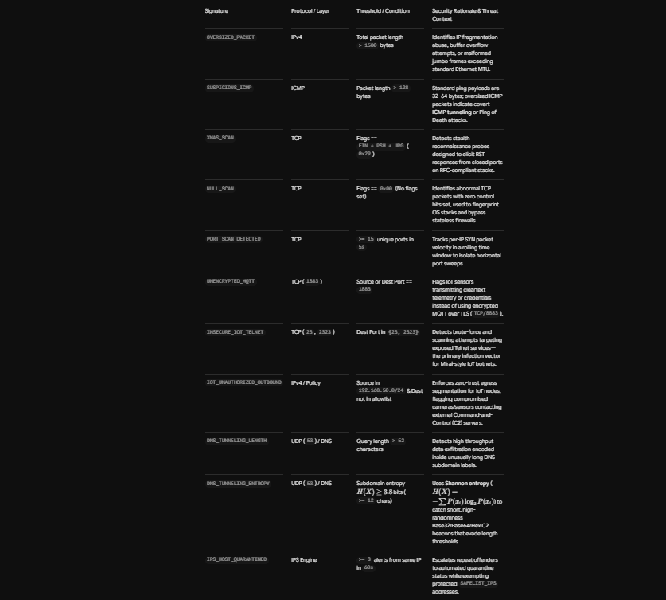
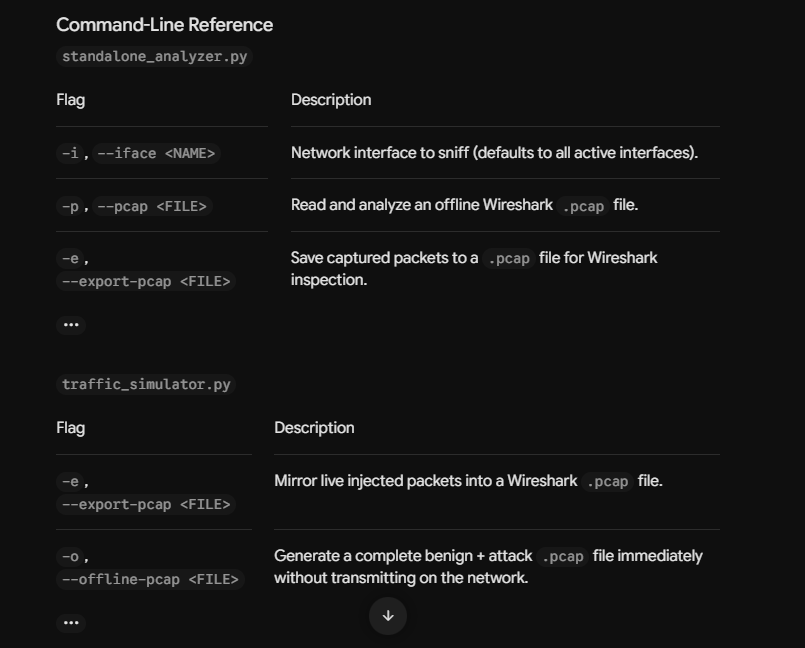

# Network Traffic Analyzer & IoT Threat Detection System


A real-time network packet analyzer, intrusion detection and prevention engine (IDS/IPS), and Wireshark PCAP forensic utility built in **Python** using **Scapy**.

Designed to address the expanding attack surface of modern **5G and IoT environments**, this self-contained tool performs deep packet inspection across Layers 3, 4, and 7—detecting stealth reconnaissance scans, payload anomalies, cleartext IoT protocols, unauthorized device egress, and covert DNS tunneling without requiring external databases or third-party cloud infrastructure.

---

## Table of Contents

1. [System Architecture](#system-architecture)
2. [Threat Detection & IPS Rules](#threat-detection--ips-rules)
3. [Live Demonstration & Forensic Verification](#live-demonstration--forensic-verification)
4. [Repository Structure](#repository-structure)
5. [Installation & Setup](#installation--setup)
6. [Usage Guide](#usage-guide)
7. [Wireshark Display Filters for Verification](#wireshark-display-filters-for-verification)
8. [Engineering Design & Threshold Tuning](#engineering-design--threshold-tuning)
9. [Future Enhancements](#future-enhancements)

## System Architecture

The solution consists of a blue-team inspection engine (`standalone_analyzer.py`) and a red-team packet generator (`traffic_simulator.py`) that interoperate over live network interfaces or standard Wireshark `.pcap` files:

```text
+-----------------------+       +-------------------------------+       +-----------------------+
|  traffic_simulator.py | ----> |    standalone_analyzer.py     | ----> |      alerts.log       |
|  (Benign + 9 Attacks) |       |  (Scapy IDS/IPS & Entropy)    |       |  (Structured Audit)   |
+-----------------------+       +-------------------------------+       +-----------------------+
           |                                    |
           v                                    v
+-----------------------+       +-------------------------------+
|  test_attacks.pcap    | <---> |          Wireshark            |
|  (PCAP Export/Replay) |       |   (Deep Packet Inspection)    |
+-----------------------+       +-------------------------------+

Core Components
Packet Capture & Dissection (standalone_analyzer.py): Captures live frames or parses offline .pcap files, extracting IPv4, TCP, UDP, ICMP, and DNS headers while tracking real-time protocol distributions and bandwidth volume.

Algorithmic & Behavioral Inspection: Combines deterministic signature checks (illegal TCP flag combinations, cleartext ports, MTU violations) with stateful velocity tracking (rolling port-scan windows), IoT subnet allowlisting, and Shannon entropy calculations.

3-Strike IPS Engine: Tracks alert strikes per source IP over a rolling 60-second window. Repeat offenders exceeding the strike threshold are automatically quarantined ([IPS BLOCKED]), while critical infrastructure (loopback, gateways, brokers) is protected via a strict safelist.

Red-Team Traffic & Attack Simulator (traffic_simulator.py): Generates continuous benign background traffic (HTTP/HTTPS, standard DNS, ICMP echo, and encrypted MQTT-TLS) alongside 9 simulated attack vectors, supporting both live injection and instant offline .pcap generation.
```



Installation & Setup
Prerequisites
Python 3.9+ (Ensure Add python.exe to PATH is selected during Windows installation)

Wireshark (Optional, for visual inspection of exported .pcap captures)

Live Capture Drivers (Only required for live sniffing/injection):

Windows: Install Npcap with "Install Npcap in WinPcap API-compatible Mode" checked, and run your terminal as Administrator.

Linux / macOS: Uses built-in libpcap; run commands with sudo.

Usage Guide
Mode 1: Offline Wireshark PCAP Generation & Analysis (Recommended Quick-Start)
Generate a Wireshark-compatible .pcap file containing 50 benign baseline packets plus all 9 simulated attack vectors, then run the analyzer against it:

# 1. Generate synthetic Wireshark PCAP

py traffic_simulator.py --offline-pcap test_attacks.pcap

# 2. Run forensic threat detection on the PCAP

py standalone_analyzer.py --pcap test_attacks.pcap

Mode 2: Live Network Capture & Real-Time Attack Simulation
Run both scripts simultaneously in two separate elevated terminals:

Terminal 1 — Start the Analyzer (with optional PCAP export for Wireshark):

py standalone_analyzer.py --export-pcap live_capture.pcap

Terminal 2 — Start the Traffic & Attack Simulator:

py traffic_simulator.py



Wireshark Display Filters for Verification
When opening test_attacks.pcap or live_capture.pcap in Wireshark, apply these display filters to isolate each simulated attack vector:

Xmas Scans (FIN, PSH, URG): tcp.flags == 0x029

NULL Scans (Zero flags): tcp.flags == 0x000

Cleartext IoT MQTT: tcp.port == 1883

Unauthorized IoT Egress: ip.src == 192.168.50.18

DNS Tunneling Queries: dns.qry.name contains "exfil" || dns.qry.name contains "c2server"

Oversized ICMP Payloads: icmp && frame.len > 128

Engineering Design & Threshold Tuning
Preventing Entropy False Positives: Short legitimate subdomains (such as api, cdn, or ntp) can yield artificially high character diversity scores. To eliminate false alarms, inspect_dns_tunneling() strips the root domain and TLD, evaluating Shannon entropy only when the subdomain payload is at least 12 characters long.

Safelist & Anti-Self-DoS Protection: Because attackers can spoof source IP addresses in raw IP headers, SAFELIST_IPS explicitly prevents loopback (127.0.0.1), local gateways, and internal brokers from ever being added to blocked_ips.

Memory-Bounded Velocity Tracking: The port-scan tracker prunes timestamps older than TIME_WINDOW (5 seconds) on every SYN packet and clears a host's buffer immediately upon alerting to prevent unbounded memory growth and alert flooding.

Future Enhancements
IPv6 Support: Extend analyze_packet() to inspect IPv6 headers, ICMPv6 neighbor discovery anomalies, and IPv6 extension header chains.

PCAP Alert-Only Filtering: Add a --alerts-only export mode so only packets that trigger security signatures are written to disk for rapid SOC triage.

Threat Intelligence Feed Integration: Cross-reference destination IPs against local abuse/C2 blocklists (AlienVault OTX / Abuse.ch CSV feeds).
